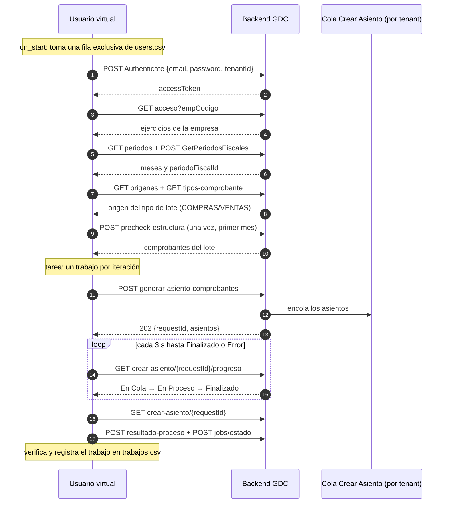

# Cómo funciona el proyecto de stress de Crear Asiento

Este documento explica cómo está armado el proyecto, qué hace un usuario virtual de principio a fin y **dónde se hace cada consulta a la API**. Para el diseño original, las restricciones del sistema (R1 a R8) y las preguntas abiertas, ver [PLAN_PRUEBAS_STRESS.md](../PLAN_PRUEBAS_STRESS.md). Para los comandos de uso, ver el [README](../README.md).

## 1. Qué hace el proyecto

Simula a muchos usuarios que, al mismo tiempo, usan la pantalla **Generar Asientos** de GDC: cada uno entra con su usuario, elige empresa, ejercicio, período y origen, genera el asiento y espera hasta que la cola de **Crear Asiento** lo termina. Mientras tanto mide los tiempos de cada paso y, al final, verifica en la base de datos que los asientos y los comprobantes contabilizados sean los esperados.

Está hecho en **Python** con **[Locust](https://locust.io/)**, una herramienta de pruebas de carga. En Locust, cada "usuario virtual" es un objeto de Python que ejecuta tareas en un bucle y hace requests HTTP; Locust lanza muchos a la vez y junta las estadísticas de cada request.

El circuito reproduce, paso por paso, la colección de Postman que se usaba para probar la pantalla a mano (pasos 01.1 a 01.7).

## 2. Mapa de carpetas

```
Stress_CodigoLocust/
├─ locustfiles/              Puntos de entrada de Locust (lo que se pasa con -f)
│  ├─ asiento_gdc.py         Escenario completo: CREA asientos
│  └─ smoke_contexto.py      Solo login + contexto (no crea nada)
├─ environments/qa.yaml      Configuración del ambiente: URL, tiempos, base de datos, umbrales
├─ data/qa/users.csv         Una fila por usuario virtual (no se versiona)
├─ .env                      Claves y datos de conexión (no se versiona)
├─ src/holistor_stress/
│  ├─ api/                   ★ Las llamadas a la API (una función por servicio)
│  ├─ flows/                 Los pasos del negocio: sesión, selección, generar, seguimiento, verificación
│  ├─ tasks/                 Las tareas de Locust (qué hace cada iteración)
│  ├─ users/                 Los usuarios virtuales de Locust
│  ├─ core/                  Arranque, contexto, pool de filas, métricas, errores, guardia de producción
│  ├─ data/                  Lectura y validación de users.csv, filtros, volumen de comprobantes
│  ├─ config/                Carga de qa.yaml + .env
│  ├─ bd/                    Verificación en la base (solo SELECT)
│  └─ reporting/             Informes: trabajos.csv, resumen.md, reporte.html, index.html
├─ tests/                    Tests automáticos (sin red ni base: usan un servidor simulado)
└─ reports/                  Una carpeta por corrida (no se versiona)
```

Las capas se usan de arriba hacia abajo, nunca al revés:

```
locustfile → users → tasks → flows → api → http.llamar → servidor
```

- **`api/`** sabe *cómo* llamar a cada servicio (método, ruta, parámetros y body), y nada más.
- **`flows/`** sabe *qué* llamar y en qué orden, y qué hacer con la respuesta (reglas de negocio).
- **`tasks/` y `users/`** deciden *cuándo*: al arrancar, en cada iteración, cuándo detenerse.

## 3. Dónde se hacen las consultas a la API

### 3.1 Un único punto de salida: `http.llamar`

**Todas** las requests pasan por la función `llamar` de [src/holistor_stress/api/http.py](../src/holistor_stress/api/http.py). Ningún otro módulo hace un request directamente. Esa función:

1. **Arma los headers:** `Accept-Language` y `Authorization: Bearer <token>` (salvo en el login).
2. **Hace el request con el cliente HTTP de Locust** (`user.client.request`), con el nombre del servicio (por ejemplo `[GDC] acceso`), para que en las estadísticas aparezca agrupado por servicio y no por URL.
3. **Aplica el timeout** `timeout_request_s` de `qa.yaml` (hoy 300 s).
4. **Interpreta la respuesta:**
   - Sin respuesta → `FallaHttp(status=0)`.
   - **401** → `NoAutorizadoError`: el token fue rechazado y el flujo vuelve a iniciar sesión.
   - Un código distinto del esperado (por ejemplo, el **503** de `acceso`) → `FallaHttp`, con el mensaje del servidor (`error.message` / `error.details`).
   - Una respuesta que no es JSON → `FallaHttp`.
5. **Desenvuelve el formato ABP** del backend (`{success, data, error}` o `result`) y devuelve solo `data`.
6. **Valida el contenido**, si quien llama pasó un `validar`: por ejemplo, que la empresa tenga el ejercicio pedido. Si no cierra, marca la falla **en ese request** y lanza `FallaDatos`.
7. **Nunca escribe el body en los mensajes,** porque el login lleva la clave.

Las rutas están todas en un solo archivo, [src/holistor_stress/api/rutas.py](../src/holistor_stress/api/rutas.py), junto con el nombre con el que cada servicio aparece en Locust. Si cambia una URL, se cambia solo ahí.

### 3.2 Los servicios que se llaman

Base: `https://gestor-comprobantes-back.azurewebsites.net` (de `environments/qa.yaml`). Los servicios de GDC cuelgan de `/api/services/app/GdcGenerarAsientos`.

| # | Servicio (nombre en Locust) | Método y ruta | Qué se envía | Qué se usa de la respuesta | Función |
|---|---|---|---|---|---|
| 01.1 | `[Auth] Authenticate` | `POST /api/services/app/Account/Authenticate` | `{email, password, tenantId}` | `accessToken` | [api/auth.py](../src/holistor_stress/api/auth.py) `authenticate` |
| 01.2 | `[GDC] acceso` | `GET …/GdcGenerarAsientos/acceso?empCodigo=` | empresa | ejercicios de la empresa (código y fechas) | [api/ejercicio.py](../src/holistor_stress/api/ejercicio.py) `acceso` |
| 01.3 | `[GDC] periodos` | `GET …/periodos?empCodigo=&ejCodigo=` | empresa y ejercicio | meses (AAAAMM) con sus fechas | [api/periodo.py](../src/holistor_stress/api/periodo.py) `periodos` |
| 01.3 | `[GDC] GetPeriodosFiscales` | `POST /api/services/app/GdcPeriodo/GetPeriodosFiscales` | `{page, limit, search: AAAAMM}` | `periodoFiscalId` del primer mes | [api/periodo.py](../src/holistor_stress/api/periodo.py) `periodos_fiscales` |
| 01.4 | `[GDC] origenes` | `GET …/origenes` | — | orígenes de comprobantes | [api/origen.py](../src/holistor_stress/api/origen.py) `origenes` |
| 01.4 | `[GDC] tipos-comprobante` | `GET …/tipos-comprobante?origenAsientoId=` | origen | `tipoLote` (COMPRAS/VENTAS) e ids de tipos de comprobante | [api/origen.py](../src/holistor_stress/api/origen.py) `tipos_comprobante` |
| 01.4 | `[GDC] precheck-estructura` | `POST …/precheck-estructura` | contexto (ver abajo) | cantidad de comprobantes del lote | [api/gdc.py](../src/holistor_stress/api/gdc.py) `precheck_estructura` |
| 01.5 | `[GDC] generar-asiento-comprobantes` | `POST …/generar-asiento-comprobantes` → **202** | contexto + `reemplazar` | `requestId` y la lista de asientos | [api/gdc.py](../src/holistor_stress/api/gdc.py) `generar_asiento_comprobantes` |
| 01.7 | `[CrearAsiento] progreso` | `GET …/crear-asiento/{requestId}/progreso` | — | estado: En Cola / En Proceso / Finalizado / Error | [api/crear_asiento.py](../src/holistor_stress/api/crear_asiento.py) `progreso` |
| 01.7 | `[CrearAsiento] resultado` | `GET …/crear-asiento/{requestId}` | — | asientos creados, con su estado | [api/crear_asiento.py](../src/holistor_stress/api/crear_asiento.py) `resultado` |
| control | `[Control] jobs/estado` | `POST …/jobs/estado` | `{asientos: [{empresa, ejercicio, idAsiento}]}` | total, aceptados, pendientes y rechazados | [api/control.py](../src/holistor_stress/api/control.py) `jobs_estado` |
| control | `[Control] resultado-proceso` | `POST …/resultado-proceso` | igual que jobs/estado | fechas de las líneas de cada asiento | [api/control.py](../src/holistor_stress/api/control.py) `resultado_proceso` |

El **contexto** que se envía al precheck y a generar se arma en `cuerpo_contexto` de [flows/gdc.py](../src/holistor_stress/flows/gdc.py):

```json
{
  "empCodigo": 3064,
  "origenAsientoId": 1,
  "ejCodigo": 2026,
  "periodoFiscalId": 123,
  "fechaDesde": "2026-01-01T00:00:00",
  "fechaHasta": "2026-06-30T00:00:00",
  "comprobantesAIncluir": "Todos",
  "tipoComprobanteIds": [1, 2, 3],
  "reemplazar": true
}
```

> ⚠ `generar-asiento-comprobantes` **crea asientos de verdad**. Con `reemplazar: true` borra y vuelve a crear los del mismo mes, tipo y módulo; eso permite repetir corridas sin acumular datos.

## 4. Lo que hace un usuario virtual, paso a paso



### 4.1 Arranque (`on_start`) — [core/base_user.py](../src/holistor_stress/core/base_user.py)

1. **Guardia de producción:** si la URL es de producción y no se pasó `--permitir-produccion`, el usuario se detiene ([core/guardia.py](../src/holistor_stress/core/guardia.py)).
2. **Toma una fila exclusiva** de `users.csv` del pool ([core/pool.py](../src/holistor_stress/core/pool.py)). Es exclusiva porque el sistema tiene **sesión única**: si dos usuarios virtuales entraran con el mismo usuario, el segundo login invalidaría el token del primero (R1).
3. **Prepara el contexto** con `preparar_contexto` ([flows/contexto.py](../src/holistor_stress/flows/contexto.py)), que corresponde a abrir la pantalla y completar los filtros:
   - Login ([flows/sesion.py](../src/holistor_stress/flows/sesion.py)).
   - Empresa y ejercicio, con `acceso` ([flows/seleccion.py](../src/holistor_stress/flows/seleccion.py) `seleccionar_empresa_ejercicio`). Elige el ejercicio que contiene el primer mes del período de la fila.
   - Período, con `periodos` y `GetPeriodosFiscales` (`seleccionar_periodo`). Quedan solo los meses del rango que caen dentro del ejercicio.
   - Origen, con `origenes` y `tipos-comprobante` (`seleccionar_origen`). Busca el origen de comprobantes cuyo tipo de lote sea el de la fila.
   - Precheck ([flows/gdc.py](../src/holistor_stress/flows/gdc.py) `precheck`). Se hace **una sola vez por usuario** y solo para el primer mes, porque la respuesta trae el lote completo, unos 2,8 KB por comprobante (R4).

### 4.2 Cada iteración: un trabajo — [flows/trabajo_gdc.py](../src/holistor_stress/flows/trabajo_gdc.py)

La tarea `GenerarAsientoGdcTask` ([tasks/asiento_tasks.py](../src/holistor_stress/tasks/asiento_tasks.py)) llama a `ejecutar_trabajo_gdc`, que:

1. **Genera** el asiento (`generar_asiento_gdc`) y guarda el `requestId`.
2. **Sigue la cola** con `esperar_finalizacion` ([flows/seguimiento.py](../src/holistor_stress/flows/seguimiento.py)): consulta `progreso` cada `polling.intervalo_s` (3 s) hasta Finalizado o Error, o hasta `polling.timeout_s` (600 s). De ahí salen tres tiempos:
   - **En Cola:** desde el 202 hasta la primera consulta con un estado distinto de En Cola.
   - **Proceso:** desde la primera consulta En Proceso hasta el final.
   - **Encolado → Finalizado:** el total.
3. **Pide el resultado** (`crear-asiento/{requestId}`) y verifica ([flows/verificacion.py](../src/holistor_stress/flows/verificacion.py)):
   - Que todos los asientos estén OK y en la empresa y el ejercicio correctos.
   - Que ningún id de asiento se repita entre trabajos de distintas filas.
   - Que las fechas de las líneas caigan dentro del período (`resultado-proceso`).
   - Que el control del servidor (`jobs/estado`) diga Finalizado, sin pendientes ni rechazados.
4. **Registra el trabajo** en `trabajos.csv`, con tiempos, cantidades, `requestId`, ids de asientos y errores.

Con `--trabajos-por-usuario 1`, cada usuario hace un trabajo y se detiene; cuando terminan todos, la corrida termina sola. Por eso `-t` es solo un tope de seguridad.

### 4.3 Qué pasa cuando algo falla

| Situación | Qué hace el usuario virtual | Dónde |
|---|---|---|
| **401** (token rechazado) | Vuelve a iniciar sesión una vez y repite el paso. Si sigue el 401, "sesión invalidada" y se detiene. | `con_sesion` en [flows/sesion.py](../src/holistor_stress/flows/sesion.py) |
| **Falla transitoria al preparar el contexto** (5xx, como el 503 de `acceso`, o timeout) | Lo reintenta en la iteración siguiente. A la **3.ª falla seguida** (`setup_reintentos_max`) se detiene **sin generar nada**. | `preparar` en [core/base_user.py](../src/holistor_stress/core/base_user.py) |
| **Error de datos** (la empresa no tiene el ejercicio, el lote no tiene comprobantes…) | Se detiene enseguida, para no insistir con una fila inválida. | `FallaDatos` |
| **Error HTTP durante el seguimiento** | Tolera hasta 3 errores seguidos; con un 404 (requestId perdido) da el trabajo por fallido. | [flows/seguimiento.py](../src/holistor_stress/flows/seguimiento.py) |
| **Falla del trabajo** (la cola terminó en Error o no cierra una verificación) | Marca el trabajo como FALLA, con el motivo, y sigue con el siguiente. | [flows/trabajo_gdc.py](../src/holistor_stress/flows/trabajo_gdc.py) |

Los tipos de error están en [core/errores.py](../src/holistor_stress/core/errores.py).

## 5. Qué se mide

Locust registra automáticamente cada request con su nombre (`[GDC] acceso`, `[GDC] generar-asiento-comprobantes`…). Además, el proyecto publica **métricas de negocio** como si fueran requests ([core/metrics.py](../src/holistor_stress/core/metrics.py)), para verlas en las mismas tablas:

| Métrica | Qué mide |
|---|---|
| `[Flujo] preparar contexto` | Todo el arranque: login, empresa, período, origen y precheck |
| `[E2E] GDC tiempo En Cola` | Espera en la cola de Crear Asiento |
| `[E2E] GDC tiempo de proceso` | Procesamiento del asiento |
| `[E2E] GDC encolado→Finalizado` | Desde el 202 hasta Finalizado |
| `[E2E] Trabajo completo` | El trabajo entero; falla si algún asiento no quedó OK o no cierra una verificación |
| `[Sesión] re-login por 401` | Re-logins por token rechazado |

## 6. Datos y configuración

- **`data/qa/users.csv`:** una fila por usuario virtual, con `tenantId`, usuario, empresa, período (por ejemplo `202601-202606`), tipo de lote y `reemplazar`. Se lee y valida en [data/users_loader.py](../src/holistor_stress/data/users_loader.py) y [data/validaciones.py](../src/holistor_stress/data/validaciones.py). Por ejemplo, no puede repetirse `(tenantId, usuario)`, ni haber dos filas con `reemplazar` sobre la misma empresa, tipo y meses. La clave vacía se toma de `HOLISTOR_QA_CLAVE` en `.env`.
- **`environments/qa.yaml`:** URL, timeouts, polling, umbrales, y la conexión a la base con su mapa `bases_por_tenant`. Cada valor se puede sobrescribir con variables `HOLISTOR__<seccion>__<clave>` ([config/loader.py](../src/holistor_stress/config/loader.py)).
- **`.env`:** claves y datos de conexión. Nunca se versiona.
- **Arranque de Locust:** [core/bootstrap.py](../src/holistor_stress/core/bootstrap.py) agrega los argumentos propios (`--target-env`, `--filtro-filas`, `--trabajos-por-usuario`…), carga la configuración y los datos, aplica la guardia y, al terminar, dispara la verificación en la base y los informes.

## 7. Verificación en la base de datos

Al terminar cada corrida, [bd/verificacion.py](../src/holistor_stress/bd/verificacion.py) ejecuta las consultas de [reporting/sql_verificacion.py](../src/holistor_stress/reporting/sql_verificacion.py) para comprobar dos cosas en cada trabajo:

- **Asientos:** en `nuc_AsientosOtrosModulos`, que los ids devueltos estén en estado OK.
- **Comprobantes:** en `gdc_ComprobanteCompraCab` / `gdc_ComprobanteVentaCab`, cuántos quedaron contabilizados con esos GUID (es la cantidad real de comprobantes que procesó el trabajo).

Para los trabajos que fallaron sin `requestId`, busca asientos "huérfanos" que el servidor pudo haber creado igual.

**Cada trabajo se consulta en la base de su tenant** (`bases_por_tenant`: 866 → QA6, 867 → QA7, 868 → QA8). La conexión es de **solo lectura**: [bd/conexion.py](../src/holistor_stress/bd/conexion.py) rechaza cualquier sentencia que no sea un único SELECT, abre la conexión con `ApplicationIntent=ReadOnly` y siempre termina en rollback.

## 8. Informes

Cada corrida deja su carpeta en `reports/<ambiente>-<fecha>-<id>_<escenario>_<N>u/` ([reporting/](../src/holistor_stress/reporting/)):

| Archivo | Contenido |
|---|---|
| `trabajos.csv` | Un renglón por trabajo: tiempos, comprobantes, asientos, `requestId`, errores |
| `locust_stats.csv`, `locust_failures.csv` | Estadísticas por servicio y fallas (UTF-8) |
| `historial.csv` | Evolución en el tiempo |
| `verificacion.sql`, `verificacion_resultado.json` | Consultas de verificación y su resultado |
| `resumen.md`, `reporte.html` | Informe de la corrida, con gráficos, hallazgos automáticos y el `analisis.md` escrito a mano |

`reports/index.html` reúne todas las corridas, con el análisis general (`reports/analisis_general.md`). Se regenera con `holistor-stress-informe`.

## 9. Tests

Los tests ([tests/](../tests/)) no usan la red ni la base: [tests/servidor_simulado.py](../tests/servidor_simulado.py) imita las respuestas del backend, y la verificación usa una conexión falsa. Se corren con:

```powershell
.\.venv\Scripts\python.exe -m pytest
```

## 10. Cómo agregar un servicio nuevo

1. Agregar la ruta y su nombre en [api/rutas.py](../src/holistor_stress/api/rutas.py).
2. Agregar una función en el módulo de `api/` que corresponda, que llame a `llamar(...)` con el método, la ruta, los parámetros o el body, y el código esperado.
3. Usarla desde un paso de `flows/`, envuelta en `con_sesion(...)` para que se reintente si da 401.
4. Agregar su respuesta en el servidor simulado y un test.

## 11. Cómo se construyó

| Fase | Qué se hizo |
|---|---|
| 1. Análisis | Se tomó la colección de Postman de la pantalla Generar Asientos (pasos 01.1 a 01.7) y se relevaron las restricciones del sistema: sesión única, cola por tenant, `reemplazar` y precheck pesado ([PLAN_PRUEBAS_STRESS.md](../PLAN_PRUEBAS_STRESS.md)). |
| 2. Base | Configuración por ambiente, `users.csv` con validaciones, pool de filas exclusivas, guardia de producción y capa `api/` con `llamar`. |
| 3. Contexto | Login y selección de empresa, ejercicio, período y origen, con el escenario `smoke_contexto` (no crea nada). |
| 4. Trabajo completo | Generar, seguimiento de la cola, resultado, verificaciones y `trabajos.csv`; escenario `asiento_gdc`. |
| 5. Informes | `resumen.md`, `reporte.html`, `index.html`, hallazgos automáticos y análisis escrito. |
| 6. Base de datos | Verificación de asientos y comprobantes contabilizados con consultas de solo lectura; volumen de comprobantes por empresa y mes. |
| 7. Multitenant | Réplica de las empresas de prueba en QA7 y QA8 (herramienta aparte, en `HerramientasQA\ReplicaTenants`), `users.csv` con 3 tenants y verificación en la base de cada tenant. |
